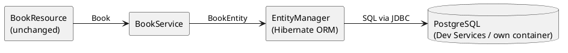

# Ex - Quarkus - JPA - Connecting to a Database

##fragment

> The book catalogue moves from a Java list into PostgreSQL. 🗃️
> Add Hibernate ORM, let Dev Services start the database, write the first entity, replace the list by the `EntityManager` - and keep every REST call and every test working

### 🙋 A quick survey first
Before we touch the pom, we collect.

##fragment

> - Start the catalogue, add a book with `POST`, restart: where is your book now? ##fragment
> - Which three things does Quarkus need to talk to a PostgreSQL database? ##fragment
> - Who creates the table `book` today - you or Hibernate? ##fragment

##fragment
- 👉 Write down your answer to the second question, we check it after step 2

### 🎯 What we build today
##side-by-side-start
#### Before: the starter
- The book catalogue from [[Ex - Quarkus - Testing with JUnit and REST Assured]]
- `BookService` keeps the books in a `CopyOnWriteArrayList`
- Ids come from an `AtomicLong`, two books are added in `@PostConstruct`
- Every restart starts from zero

##separator
##fragment

#### After: the catalogue on a database
- `BookEntity` is the table `book` in PostgreSQL
- `BookService` works with the `EntityManager`
- Dev Services starts PostgreSQL in dev mode and in tests
- `import.sql` seeds the same two books
- The packaged jar runs against **your own** PostgreSQL container, and the data survives a restart

##side-by-side-end
##fragment

> [!note]
> The theory is in [[Quarkus - JPA - Connecting to a Database]]. This exercise applies it to the catalogue: same vocabulary (entity, `EntityManager`, persistence context, Dev Services, schema management), different domain. `BookResource` and the REST API do **not** change at all.

### 👀 The finished thing
At the end of the lesson, this is what you see in your own PostgreSQL container:

##fragment

```text
catalogue=# \dt
        List of relations
 Schema | Name | Type  | Owner
--------+------+-------+-------
 public | book | table | app
```

##fragment
- The table `book` was created by Hibernate from a Java class, you wrote no `CREATE TABLE`
- You stopped the application, started it again, and the books were still there
- The REST calls are the same as before: `curl localhost:8080/books` does not know that a database is behind it

### 🗺️ The path through the layers


##fragment
- The record `Book` stays the **REST DTO**: JSON in, JSON out, with its validation constraints
- The new class `BookEntity` is what Hibernate maps to the table; `BookService` converts between the two
- Only the service changes - the resource still calls `find`, `get`, `add` and `remove`

### 🕐 Agenda: 100 minutes
| Step | Minutes | Content                                         | You end the step with                                      |
| ---- | ------- | ----------------------------------------------- | ---------------------------------------------------------- |
| 0    | 8       | Clone, run the in-memory starter                | `curl localhost:8080/books` returns two books              |
| 1    | 8       | Add Hibernate ORM and the PostgreSQL driver     | `docker ps` shows a `postgres:18` container                |
| 2    | 8       | The datasource keys                             | Dev Services on port 5432, SQL log switched on             |
| 3    | 15      | The first entity: `BookEntity`                  | The log shows `create table book`                          |
| 4    | 20      | `BookService` on the `EntityManager`            | `curl localhost:8080/books` returns `[]`, `POST` works     |
| 5    | 12      | Seed data with `import.sql`                     | Dune and Solaris are back, a new book gets id 100          |
| 6    | 12      | Repair the tests                                | `./mvnw test`: 19 tests green                              |
| 7    | 12      | Your own PostgreSQL for the packaged jar        | Data survives a restart, `\dt` shows the table             |
| -    | 5       | Summary, extensions                             | You know what to try next                                  |

##fragment
- Each step ends with a **checkpoint** ⏰: stop there until the class is with you

### 🧰 Setup: clone the starter
```bash
git clone <STARTER-REPO-URL> catalogue-jpa
cd catalogue-jpa
```

##fragment
- Open the folder in **IntelliJ IDEA Ultimate**, let it import the Maven project
- Quarkus 3.40, Java 25 or newer, and today a **container runtime is required**: Docker or Podman must be running
- 👉 Run `docker ps` (or `podman ps`) now. An error here means Dev Services will fail in step 1

## 🚀 Step 0: The starter
> First we see what we are about to replace.

### ▶️ Run it
```bash
./mvnw quarkus:dev
curl localhost:8080/books
```

##fragment
- Expected: a JSON array with `Dune` (id 1) and `Solaris` (id 2)
- Open `BookService`: the books live in a list, `seed()` adds two of them in `@PostConstruct`, `nextId` hands out the ids

### 💥 The problem in one experiment
```bash
curl -i -X POST localhost:8080/books -H 'Content-Type: application/json' -d '{"title":"Neuromancer","author":"Gibson","year":1984}'
```

##fragment
- Expected: `201 Created` and id 3
- Now press `q` in the dev mode terminal and start `./mvnw quarkus:dev` again
- `curl localhost:8080/books`: Neuromancer is gone. The list lives in the memory of the JVM, and the JVM is gone

### ⏰ Everybody ready?
> Two books, a third one added, a restart, and the third one lost. Leave dev mode running

## 📦 Step 1: Hibernate ORM and the driver
> Two dependencies, and Quarkus already starts a database for you.

### 🧱 Two dependencies
In `pom.xml`, add these two next to `quarkus-arc`:

##fragment

##side-by-side-start
```xml
        <dependency>
            <groupId>io.quarkus</groupId>
            <artifactId>quarkus-hibernate-orm</artifactId>
        </dependency>
        <dependency>
            <groupId>io.quarkus</groupId>
            <artifactId>quarkus-jdbc-postgresql</artifactId>
        </dependency>
```

##separator
##fragment

- `quarkus-hibernate-orm` brings Hibernate ORM, Jakarta Persistence, JTA transactions and the Agroal connection pool
- `quarkus-jdbc-postgresql` is the **JDBC driver** - the only part that changes for another database
- No `<version>`: it comes from the Quarkus BOM
- Press the Maven reload button in IntelliJ (the small `m` icon)

##side-by-side-end

### ▶️ Restart dev mode
Press `q`, then start dev mode again:

##fragment

```bash
./mvnw quarkus:dev
docker ps
```

##fragment
- 👀 Watch the log: `Dev Services for default datasource (postgresql) started`
- `docker ps` shows a container with the image `postgres:18` (and a small `testcontainers/ryuk` that cleans up after you)
- There is no `jdbc.url` in `application.properties`, and exactly this **missing** URL is the trigger for Dev Services
- A line saying that Hibernate ORM found no entities is expected - we have none yet

### ⏰ Is your database running?
> `docker ps` lists `postgres:18`. If the log says it cannot find a container runtime, start Docker or Podman and restart dev mode

## 🔧 Step 2: The datasource keys
> Write down what Quarkus guessed, and switch on the SQL log.

### ⚙️ application.properties
Add this block below the `catalogue.*` keys in `application.properties`:

##fragment

##side-by-side-start
```ini
# database: Dev Services starts PostgreSQL in dev mode and in tests
quarkus.datasource.db-kind=postgresql
quarkus.hibernate-orm.schema-management.strategy=drop-and-create
quarkus.hibernate-orm.log.sql=true
%dev.quarkus.datasource.devservices.port=5432
```

##separator
##fragment

- `db-kind` is all a Dev Services datasource needs: no URL, no user, no password
- `drop-and-create` throws the schema away at every start and builds it from the entities
- `log.sql` prints every statement Hibernate sends - leave it on
- `%dev.` fixes the port **only in dev mode**, so IntelliJ can connect to a stable address; tests keep a random port and can run next to dev mode
- The `catalogue.*` keys stay as they are

##side-by-side-end

### ▶️ Check the port
Save the file. If dev mode does not restart the container by itself, press `q` and start it again.

##fragment

```text
Container is started (JDBC URL: jdbc:postgresql://localhost:5432/quarkus?loggerLevel=OFF)
```

##fragment
- The log line shows port **5432** now
- User, password and database of the Dev Services container are all `quarkus`
- ⚠️ A PostgreSQL installed on your laptop also wants 5432 - stop it, or the container cannot start
- 👉 Compare with your note from the survey: driver, `db-kind`, and a running database

### ⏰ Port 5432?
> The JDBC URL in the log ends in `:5432/quarkus`. `curl localhost:8080/books` still returns the two in-memory books - nothing uses the database yet

## 🧱 Step 3: The first entity
> One class, and Hibernate creates the table from it.

### 🧩 BookEntity
Create `BookEntity` in `src/main/java/at/htl/catalogue`:

##fragment

##side-by-side-start
```java
@Entity
@Table(name = "book")
public class BookEntity {

    @Id
    @GeneratedValue
    public Long id;
    public String title;
    public String author;
    public int year;
}
```

##separator
##fragment

- `@Entity` makes the class persistent, one object is one row
- `@Table(name = "book")` names the table; without it the table would be called `BookEntity`
- `@Id` marks the primary key, `@GeneratedValue` lets Hibernate take the value from a **sequence**
- Every other field becomes a column, no annotation needed
- Public fields keep it short; Hibernate in Quarkus treats them like private fields with accessors
- Imports: `jakarta.persistence.*` - **not** `javax.persistence`

##side-by-side-end

### 🔁 Convert between entity and record
Add two methods to `BookEntity`:

##fragment

##side-by-side-start
```java
    public Book toBook() {
        return new Book(id, title, author, year);
    }

    public static BookEntity from(Book book) {
        BookEntity entity = new BookEntity();
        entity.title = book.title();
        entity.author = book.author();
        entity.year = book.year();
        return entity;
    }
```

##separator
##fragment

- `toBook()` turns a row into the DTO that `BookResource` sends as JSON
- `from(Book)` does the opposite for `POST`, and leaves `id` empty on purpose: the database chooses it
- Why not make `Book` itself the entity? A record is immutable and has no no-args constructor - JPA needs both

##side-by-side-end

### 👀 Read the log
Save, then call `curl localhost:8080/books` once to trigger the restart:

##fragment

```log
    drop table if exists book cascade
    drop sequence if exists book_SEQ
    create sequence book_SEQ start with 1 increment by 50
    create table book (
        year integer not null,
        id bigint not null,
        author varchar(255),
        title varchar(255),
        primary key (id)
    )
```

##fragment
- `drop-and-create` at work: first everything is dropped, then built again from the entity
- `book_SEQ` is the sequence behind `@GeneratedValue`; **increment by 50** means Hibernate reserves ids in blocks of 50 - remember that for step 5
- `year` is `not null` because `int` cannot be `null`, `title` and `author` can
- 👉 The column order is not the field order. Does that matter?

### ⏰ Table created?
> The log shows `create sequence book_SEQ` and `create table book`. The REST API still answers from the list

## 💉 Step 4: The service on the EntityManager
> The list goes, the database comes. The resource does not notice.

### 🗑️ Remove the list
In `BookService`:

##fragment

> - Delete the fields `books` and `nextId` ##fragment
> - Delete the `@PostConstruct` method `seed()` ##fragment
> - In `Book`, delete the method `withId` - nobody calls it anymore ##fragment

##fragment
- The class does not compile now. That is fine: the next slides fill the gaps one method at a time

### 💉 Inject the EntityManager
Add the field and the constructor parameter:

##fragment

##side-by-side-start
```java
    private final EntityManager em;

    public BookService(EntityManager em,
                       @Named("log") Notifier notifier,
                       Event<BookCreated> events,
                       CatalogueConfig config) {
        this.em = em;
        this.notifier = notifier;
        this.events = events;
        this.config = config;
    }
```

##separator
##fragment

- The `EntityManager` is a bean like any other, so **constructor injection** works
- It is the API to load, save, delete and query entities
- Import `jakarta.persistence.EntityManager`

##side-by-side-end

### 🔎 find: a JPQL query
Replace the body of `find`:

##fragment

##side-by-side-start
```java
        TypedQuery<BookEntity> query = author == null
                ? em.createQuery("from BookEntity order by id", BookEntity.class)
                : em.createQuery("from BookEntity where lower(author) = lower(:author) order by id", BookEntity.class)
                        .setParameter("author", author);
        return query.setMaxResults(config.maxResults())
                .getResultStream()
                .map(BookEntity::toBook)
                .toList();
```

##separator
##fragment

- **JPQL** talks about **classes and fields** (`BookEntity`, `author`), not about tables and columns
- `:author` is a named parameter - never glue user input into the query string
- `lower(...)` on both sides keeps the old behaviour of `equalsIgnoreCase`
- `setMaxResults` replaces `limit(...)`: the limit is now part of the SQL, the database returns only that many rows
- Import `jakarta.persistence.TypedQuery`

##side-by-side-end

### 🔑 get: find by primary key
Replace the body of `get`:

##fragment

##side-by-side-start
```java
        BookEntity entity = em.find(BookEntity.class, id);
        if (entity == null) {
            throw new BookNotFoundException(id);
        }
        return entity.toBook();
```

##separator
##fragment

- `em.find` loads one entity by its id, or returns `null`
- The `BookNotFoundException` stays, so the exception mapper still answers `404`
- Reading needs **no** transaction

##side-by-side-end

### ✍️ add: persist in a transaction
In `add`, put `@Transactional` on the method and replace the two lines that used `withId` and the list:

##fragment

##side-by-side-start
```java
    @Transactional
    public Book add(Book book) {
        BookEntity entity = BookEntity.from(book);
        em.persist(entity);
        Book saved = entity.toBook();
        events.fire(new BookCreated(saved));
        notifier.send("New book: " + saved.title());
        return saved;
    }
```

##separator
##fragment

- `@Transactional` (`jakarta.transaction.Transactional`) opens a transaction before the method and commits it after
- `persist` makes the entity **managed**: it is now in the persistence context, and `id` is filled from the sequence
- The `INSERT` itself is sent at commit, at the end of the method
- The event and the notification stay unchanged

##side-by-side-end

### 🗑️ remove: find, then remove
Replace `remove`:

##fragment

##side-by-side-start
```java
    @Transactional
    public void remove(long id) {
        BookEntity entity = em.find(BookEntity.class, id);
        if (entity != null) {
            em.remove(entity);
        }
    }
```

##separator
##fragment

- `em.remove` needs a **managed** entity, so we load it first
- Unknown id: nothing happens, as before with `removeIf`
- Writing needs `@Transactional`, otherwise Hibernate refuses with a `TransactionRequiredException`

##side-by-side-end

### ▶️ Verify
```bash
curl localhost:8080/books
curl -i -X POST localhost:8080/books -H 'Content-Type: application/json' -d '{"title":"Neuromancer","author":"Gibson","year":1984}'
curl localhost:8080/books/1
```

##fragment
- First call: `[]` - the table is empty, the seed is gone with `seed()`
- `POST`: `201 Created`, id **1**, `Location: http://localhost:8080/books/1`
- 👀 The log shows `select nextval('book_SEQ')` and `insert into book ...`
- The dev mode log may complain that the tests do not compile: ignore it until step 6

### ⏰ Empty list, then one book?
> `GET` returns `[]`, `POST` returns id 1 and the log shows the `insert`. If not, compare `BookService` with `final-code`

## 🌱 Step 5: Seed data with import.sql
> Every start gets the same two books again - this time from SQL.

### 🌱 import.sql
Create `src/main/resources/import.sql`:

##fragment

```sql
INSERT INTO book (id, title, author, year) VALUES (1, 'Dune', 'Herbert', 1965);
INSERT INTO book (id, title, author, year) VALUES (2, 'Solaris', 'Lem', 1961);
```

##fragment
- Quarkus runs `import.sql` **after** `drop-and-create`, in dev mode and in tests - never in production
- This is SQL, not JPQL: table and column names, not class and field names
- `curl localhost:8080/books`: Dune and Solaris are back

### 💥 Now POST again
```bash
curl -i -X POST localhost:8080/books -H 'Content-Type: application/json' -d '{"title":"Neuromancer","author":"Gibson","year":1984}'
```

##fragment
- Expected: `500 Internal Server Error`
- The log: `duplicate key value violates unique constraint "book_pkey"` with `Key (id)=(1) already exists`
- 👉 Why id 1? The sequence starts at 1, nobody told it that `import.sql` already used ids 1 and 2

### 🔧 Move the sequence
Add two lines at the end of `import.sql`:

##fragment

```sql
-- Hibernate takes ids in blocks of 50 from this sequence: move it past the rows above
ALTER SEQUENCE book_seq RESTART WITH 100;
```

##fragment
- `book_SEQ` from the DDL is `book_seq` in PostgreSQL: unquoted names are folded to lower case
- Hibernate takes the next **block** from the sequence: 100 to 149
- Repeat the `POST`: `201 Created`, id **100**, `Location: http://localhost:8080/books/100`
- ⚠️ This line is PostgreSQL dialect - `import.sql` is written in **one** dialect

### ⏰ Dune, Solaris and id 100?
> `GET /books` returns Dune and Solaris, the next `POST` gets id 100. Note: in dev mode the list shows at most 5 books (`%dev.catalogue.max-results=5`)

## 🧪 Step 6: Repair the tests
> A safety net is only useful if it still compiles.

### 💥 Run the tests
Press `q` to stop dev mode, then:

##fragment

```bash
./mvnw test
```

##fragment
- Expected: `COMPILATION ERROR` in `BookServiceTest`
- The test calls `new BookService(silent, events, new TestConfig())`, but the constructor now wants an `EntityManager` as well
- A fake `EntityManager` would test nothing: the logic now **is** the database query. So the test gets the real service on the real database

### 🔧 BookServiceTest on the database
In `BookServiceTest`, delete `setUp()`, the `service` field and the nested `TestConfig`, and annotate the class:

##fragment

##side-by-side-start
```java
@QuarkusTest
@TestTransaction
class BookServiceTest {

    // the real service on the real (Dev Services) database,
    // every test is rolled back at the end
    @Inject
    BookService service;
```

##separator
##fragment

- `@QuarkusTest` starts the application with Dev Services, on a **random** port this time
- `@TestTransaction` (`io.quarkus.test.TestTransaction`) runs every test method in a transaction and **rolls it back** at the end - no test leaves rows behind
- Remove the now unused imports of `Mockito`, `Event` and `BeforeEach`

##side-by-side-end

### ✏️ One test changes
`findFiltersByAuthor` must not add Dune and Solaris again, `import.sql` already did. Replace its body:

##fragment

```java
        service.add(new Book(null, "Ubik", "Dick", 1969));

        List<Book> result = service.find("dick");

        assertEquals(1, result.size());
        assertEquals("Ubik", result.get(0).title());
```

##fragment
- A new author, so exactly one book matches - whatever else is in the table
- `"dick"` in lower case checks the `lower(...)` in the JPQL
- `unknownIdThrowsNotFound` and `addAssignsAnId` stay unchanged

### ▶️ Run all tests
```bash
./mvnw test
```

##fragment
- Expected: `Tests run: 19, Failures: 0, Errors: 0`
- `BookResourceTest`, `LimitedListTest` and `AdminEndpointTest` did **not** change: they test over HTTP, and HTTP did not change
- 👀 In the log: a fresh `postgres:18` container on a random port, started just for the tests
- 👉 `getByIdReturnsOneBook` expects id 1 with author Herbert. Where does that book come from now?

### ⏰ 19 green tests?
> `./mvnw test` ends with `BUILD SUCCESS`. If a test fails with `404`, check that `import.sql` is in `src/main/resources`

## 🏭 Step 7: Your own PostgreSQL
> Dev Services is for development. The packaged jar needs a real database.

### ⚙️ The prod profile
Add this block at the end of `application.properties`:

##fragment

##side-by-side-start
```ini
# database: your own PostgreSQL for the packaged application
%prod.quarkus.datasource.jdbc.url=jdbc:postgresql://localhost:5432/catalogue
%prod.quarkus.datasource.username=app
%prod.quarkus.datasource.password=app
%prod.quarkus.hibernate-orm.schema-management.strategy=update
```

##separator
##fragment

- `%prod.` means: only when the application runs packaged, **not** in dev mode and not in tests
- The URL format is the one from [[Java JDBC]]: `jdbc:<vendor>://<host>:<port>/<database>`
- `update` creates missing tables and keeps existing rows - `drop-and-create` would wipe the data at every start
- ⚠️ Never commit real passwords; in a container they come from environment variables

##side-by-side-end

### 🐘 Start the database container
Dev mode must be **stopped** (`q`): its container also wants port 5432.

##fragment

```bash
docker run -d --name catalogue-db -p 5432:5432 -e POSTGRES_USER=app -e POSTGRES_PASSWORD=app -e POSTGRES_DB=catalogue docker.io/library/postgres:18
```

##fragment
- User, password and database name match the three `%prod.` keys
- `docker ps` shows `catalogue-db` on `0.0.0.0:5432`

### 📦 Package and run
```bash
./mvnw package -DskipTests
java -jar target/quarkus-app/quarkus-run.jar
```

##fragment
- `-DskipTests`: the tests already ran in step 6, and packaging should be quick
- The log shows `create table book` again, this time from `update` - and **no** `import.sql`
- In a second terminal: `curl localhost:8080/books` returns `[]`, then `POST` Neuromancer: id **1**

### 🔁 Restart: is the data still there?
Stop the jar with `Ctrl+C`, start it again with the same `java -jar` command.

##fragment

- `curl localhost:8080/books`: Neuromancer is **still there** - this is what we wanted in step 0
- The log has no `create table` this time: `update` found the table and left it alone
- 👉 `POST` another book. Which id does it get, and why not 2? (Think of the blocks of 50.)

### ⌨️ Look into the database
```bash
docker exec -it catalogue-db psql -U app -d catalogue
```

##fragment
- `\dt` lists the table `book`, `select * from book;` shows your rows, `\q` quits
- `-it` gives you an interactive terminal; without it `psql` starts and ends right away
- No command line at hand? Open the container in Docker Desktop or Podman Desktop and use the **Terminal** tab

### ⏰ Data survived?
> Your books are still there after a restart, and `psql` shows them. Stop the jar and run `docker stop catalogue-db` when you are done

## 🌍 Summary
### 📋 What you built
> - `quarkus-hibernate-orm` plus `quarkus-jdbc-postgresql` plus `db-kind` is a working setup
> - Dev Services starts PostgreSQL in dev mode and in tests, no installation
> - `BookEntity` is the table, the record `Book` stays the REST DTO
> - `BookService` reads with `em.find` and JPQL, writes with `persist` and `remove` under `@Transactional`
> - `import.sql` seeds dev and test, the sequence has to be moved past the seeded ids
> - `%prod.` points the packaged jar to your own PostgreSQL, `update` keeps the data

##fragment
- 👉 Compare your version with `final-code`: which method looks different in your `BookService`?

### 🚀 Extensions for fast ones
> - Switch to MySQL in dev mode: replace the driver by `quarkus-jdbc-mysql`, set `db-kind=mysql`, drop the `devservices.port` line, and compare the DDL in the log with PostgreSQL. What happens to the `ALTER SEQUENCE` line in `import.sql`? ##fragment
> - Add `quarkus.hibernate-orm.log.bind-parameters=true` and call `GET /books?author=Lem`: which value shows up for the `?` ##fragment
> - Open the Dev UI at `localhost:8080/q/dev-ui`, find the **Hibernate ORM** card and look for the persistence unit, the entity `BookEntity` and the generated DDL ##fragment

##fragment
- 👉 For the MySQL extension: write down every line in `pom.xml` and `application.properties` you had to change - and count the Java lines

## Questions ?
![[Pasted image 20240424074417.png]]

## References
- https://quarkus.io/guides/hibernate-orm
- https://quarkus.io/guides/datasource
- https://quarkus.io/guides/databases-dev-services
- https://quarkus.io/guides/dev-ui
- https://quarkus.io/guides/getting-started-testing
- https://jakarta.ee/specifications/persistence/
- https://docs.jboss.org/hibernate/orm/7.0/introduction/html_single/Hibernate_Introduction.html
- https://hub.docker.com/_/postgres

## 📎 Optional deep dives and backup slides
### 🔬 Deep dive: why ids come in blocks of 50
- `@GeneratedValue` without a strategy uses a sequence with the **pooled** optimizer: one `nextval` reserves 50 ids
- That saves 49 round trips to the database for 50 inserts
- The price: gaps. After a restart the next block starts, so ids jump - ids are identities, not counters

### 🔬 Deep dive: the persistence context in `add`
- After `persist` the entity is **managed**: change `entity.title` before the method ends and the `UPDATE` is sent at commit without any call
- This is dirty checking, explained in [[Quarkus - JPA - EntityManager and Transactions]]
