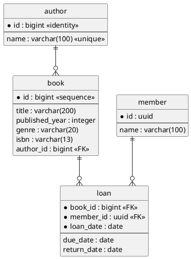

# Ex - Quarkus - JPA - Object-Relational Mapping

##fragment

> One table becomes a model. 🔗
> Map columns, an enum and a value type, turn the author string into an entity, add members with UUID keys and loans with a composite key - and read every step in the generated `CREATE TABLE`

### 🙋 A quick survey first
Before we change a single annotation, we collect.

##fragment

> - Today `author` is a string in every book row. What goes wrong when you mistype "Herbert" once? ##fragment
> - A member borrows a book. Which columns does the loan row need, and what is its key? ##fragment
> - Your enum gets a new constant in the middle. What happens to the rows already in the database? ##fragment

##fragment
- 👉 Sketch the tables `book`, `author`, `member`, `loan` on paper with all keys - we compare with the log at the end

### 🎯 What we build today


##fragment
- Four tables, three ways to create a key: a **sequence** (book), **`IDENTITY`** (author), a **UUID from Java** (member) - and a **composite key** built from other keys (loan)
- `/books` keeps working exactly as before, `GET /authors`, `GET /authors/{id}/books`, `GET/POST /loans` are new
- Every arrow is a foreign key column on the "many" side

### 🧭 Where this comes from
##side-by-side-start
#### Today's starting point
- The catalogue from [[Ex - Quarkus - JPA - Connecting to a Database]]
- One entity `BookEntity`, the author is a plain string
- PostgreSQL via Dev Services, seed rows in `import.sql`
- All tests green

##separator
##fragment

#### Today's end point
- 4 entities, 1 enum, 1 value type with a converter
- `@ManyToOne` and `@OneToMany(mappedBy)`
- `@EmbeddedId` with `@MapsId`
- 30 green tests

##side-by-side-end
##fragment

> [!note]
> The theory is in [[Quarkus - JPA - Object-Relational Mapping]]. This exercise applies it to the catalogue. Entities never leave the service: resources keep returning the DTO records, as in [[Ex - Quarkus - REST and CDI]].

### 🕐 Agenda: 100 minutes
| Step | Minutes | Content                                        | You end the step with                                  |
| ---- | ------- | ---------------------------------------------- | ------------------------------------------------------ |
| 0    | 8       | Clone, start dev mode, read the DDL            | `curl localhost:8080/books` returns two books          |
| 1    | 8       | `@Column`: names, lengths, `not null`          | `published_year integer not null` in the log           |
| 2    | 9       | Enum `Genre` as `STRING`                       | An unknown genre is answered with `400`                |
| 3    | 10      | Value type `Isbn` with a converter             | `"isbn":"12"` is answered with `400`                   |
| 4    | 15      | `AuthorEntity` and `@ManyToOne`                | A new book creates its author, id `100`                |
| 5    | 14      | `@OneToMany(mappedBy)` and `/authors`          | `/authors/1/books` returns Dune                        |
| 6    | 5       | `MemberEntity` with a UUID key                 | `id uuid not null` in the log                          |
| 7    | 13      | `LoanEntity` with a composite key              | `primary key (loan_date, book_id, member_id)`          |
| 8    | 10      | The loans API                                  | Ada borrows Dune, due in four weeks                    |
| 9    | 8       | Tests from `final-code`                        | `Tests run: 30, Failures: 0`                           |

##fragment
- Each step ends with a **checkpoint** ⏰: stop there until the class is with you
- The plan is tight. Step 9 is mostly copying - if time runs out, it is homework

### 🧰 Setup: clone the starter
```bash
git clone <STARTER-REPO-URL> catalogue-orm
cd catalogue-orm
```

##fragment
- Open the folder in **IntelliJ IDEA Ultimate**, let it import the Maven project
- Quarkus 3.40, Java 25 or newer, **Docker or Podman must run**: Dev Services starts PostgreSQL
- Look at `BookEntity`, `BookService` (it uses the `EntityManager`) and `src/main/resources/import.sql`

## 🚀 Step 0: Run and read the DDL
> The log is our proof today. Every mapping ends up as a line of SQL.

### ▶️ Start dev mode
```bash
./mvnw quarkus:dev
curl localhost:8080/books
```

##fragment
- Expected: a JSON array with `Dune` (id 1, Herbert) and `Solaris` (id 2, Lem)
- Scroll up in the dev mode log to `create table book`: `quarkus.hibernate-orm.log.sql=true` prints every statement
- Keep dev mode running the whole lesson. After every change, the next `curl` reloads the application

### 🔁 How a reload works today
> - Save a file, send a request - Quarkus restarts the application ##fragment
> - `drop-and-create` drops all tables and creates them again from the entities ##fragment
> - Then `import.sql` runs and inserts the seed rows ##fragment

##fragment
- Data you created with `POST` is **gone** after every change - send the request again after each step
- 👉 That is why the log shows a fresh `create table` after every save: read it every time

### ⏰ Everybody ready?
> `curl localhost:8080/books` returned two books, and you found `create table book` in the log

## 🏷️ Step 1: Columns
> Every field is a column - we decide its name, its length and whether it may be empty.

### ✏️ Annotate the fields
In `BookEntity`, put `@Column` on the three fields below `id`:

##fragment

##side-by-side-start
```java
    @Column(nullable = false, length = 200)
    public String title;

    @Column(nullable = false, length = 100)
    public String author;

    @Column(name = "published_year", nullable = false)
    public int year;
```

##separator
##fragment

- `length` turns `varchar(255)` into `varchar(200)`, `nullable = false` adds `not null`
- Both only change the **generated DDL** - Java does not check them, the database does
- `year` is a keyword or function in several SQL dialects, so the column gets a clear name of its own
- The Java field and the JSON property stay `year`: the column name is a database detail
- Import `jakarta.persistence.Column`

##side-by-side-end

### 🗃️ Follow the rename in the seed data
In `import.sql`, the column `year` does not exist any more. Replace the two `INSERT` lines:

##fragment

```sql
INSERT INTO book (id, title, author, published_year) VALUES (1, 'Dune', 'Herbert', 1965);
INSERT INTO book (id, title, author, published_year) VALUES (2, 'Solaris', 'Lem', 1961);
```

##fragment
- `import.sql` speaks **SQL**, not Java: it uses column names, not field names
- Leave the `ALTER SEQUENCE` line below untouched
- 👉 What would happen if you forgot this rename? Predict it, then read the log if it happens to you

### ▶️ Verify
```bash
curl localhost:8080/books
```

##fragment
- Expected: the same two books as before, still with `"year":1965`
- In the log, inside `create table book`: `title varchar(200) not null`, `author varchar(100) not null`, `published_year integer not null`
- The order of the columns in the DDL may differ from your class - Hibernate sorts them itself

### ⏰ Columns mapped?
> Three `not null` columns and `published_year` in the log, two books from `curl`

## 🎭 Step 2: An enum as `STRING`
> A genre is one of a few fixed values. The database has to store it so that it still means the same thing next year.

### 🧩 The enum
Create `Genre` in `at.htl.catalogue`:

##fragment

##side-by-side-start
```java
public enum Genre {
    SCIENCE_FICTION,
    FANTASY,
    CRIME,
    NON_FICTION
}
```

##separator
##fragment

- Constants in `UPPER_SNAKE_CASE`, as always in Java
- The **names** of the constants are what the database and the JSON will contain

##side-by-side-end

### ⚠️ Why not the default
##side-by-side-start
#### `ORDINAL` (the default)
> - `SCIENCE_FICTION` is stored as `0`, `FANTASY` as `1`, `CRIME` as `2` ##fragment
> - Next year somebody adds `HORROR` between `FANTASY` and `CRIME` ##fragment
> - Every existing crime novel now reads as `HORROR` - no error, no warning ##fragment

##separator
##fragment

#### `STRING`
> - Stores `'CRIME'`: readable in every SQL tool ##fragment
> - Order of the constants does not matter ##fragment
> - Renaming a constant still needs a migration - but you notice it ##fragment

##side-by-side-end
##fragment
- 👉 Rule from [[Quarkus - JPA - Object-Relational Mapping]]: **always** `EnumType.STRING`

### ✏️ The entity field
Add the field to `BookEntity`, below `year`:

##fragment

##side-by-side-start
```java
    @Enumerated(EnumType.STRING)
    @Column(length = 20)
    public Genre genre;
```

##separator
##fragment

- `@Enumerated(EnumType.STRING)` stores the name of the constant
- `length = 20` fits the longest name, `SCIENCE_FICTION`
- No `nullable = false`: the seed rows get their genre only in step 4
- Imports: `jakarta.persistence.Enumerated`, `jakarta.persistence.EnumType`

##side-by-side-end

### 📦 The DTO gets a genre
In `Book`, add the component after `year`, and a short constructor inside the record body:

##fragment

##side-by-side-start
```java
        @Min(1450) int year,
        Genre genre) {

    public Book(Long id, String title, String author, int year) {
        this(id, title, author, year, null);
    }
```

##separator
##fragment

- The record has five components now, so every `new Book(...)` with four arguments would break
- The **short constructor** delegates with `null` for the genre: all existing tests and calls keep compiling
- A missing genre in the JSON body simply becomes `null`

##side-by-side-end

### 🔁 Entity and DTO in both directions
In `BookEntity`, pass the genre on in `toBook()` and take it over in `from(...)`:

##fragment

```java
        return new Book(id, title, author, year, genre);
```

```java
        entity.genre = book.genre();
```

##fragment
- The first line replaces the `return` in `toBook()`, the second one goes into `from(...)` next to `entity.year = ...`

### ▶️ Verify
```bash
curl -i -X POST localhost:8080/books -H "Content-Type: application/json" -d '{"title":"Neuromancer","author":"Gibson","year":1984,"genre":"SCIENCE_FICTION"}'
curl -i -X POST localhost:8080/books -H "Content-Type: application/json" -d '{"title":"Neuromancer","author":"Gibson","year":1984,"genre":"POETRY"}'
```

##fragment
- First request: `201`, the body contains `"genre":"SCIENCE_FICTION"`
- Second request: `400` - Jackson cannot turn `POETRY` into a `Genre`, the request never reaches the service
- In the log: `genre varchar(20)` with a `check` constraint listing the four names - Hibernate guards the enum in the database too

### ⏰ Genre stored?
> `201` with a genre, `400` for `POETRY`, and the `check` constraint in the log

## 🔄 Step 3: A value type with a converter
> An ISBN is not just any string. We give it a type of its own - and teach JPA to store it.

### 🧩 The value type
Create the record `Isbn`:

##fragment

##side-by-side-start
```java
public record Isbn(String value) {

    public Isbn {
        if (value == null || !value.matches("\\d{13}")) {
            throw new IllegalArgumentException("An ISBN has 13 digits: " + value);
        }
    }
}
```

##separator
##fragment

- The **compact constructor** runs on every `new Isbn(...)`: an invalid `Isbn` object cannot exist
- `\\d{13}` in Java source is the regex `\d{13}`: exactly 13 digits
- JPA does not know this type - it would not know which column type to use

##side-by-side-end

### 🔌 The converter
Create `IsbnConverter`:

##fragment

##side-by-side-start
```java
@Converter(autoApply = true)
public class IsbnConverter implements AttributeConverter<Isbn, String> {

    @Override
    public String convertToDatabaseColumn(Isbn isbn) {
        return isbn == null ? null : isbn.value();
    }

    @Override
    public Isbn convertToEntityAttribute(String value) {
        return value == null ? null : new Isbn(value);
    }
}
```

##separator
##fragment

- An `AttributeConverter<Isbn, String>` maps **one** Java value to **one** column
- `autoApply = true`: every field of type `Isbn` in every entity uses it, no annotation on the field needed
- Both directions must handle `null` - a book without ISBN is allowed
- Imports from `jakarta.persistence`

##side-by-side-end

### ✏️ Entity and DTO
In `BookEntity`, below `genre`:

##fragment

```java
    @Column(length = 13)
    public Isbn isbn;
```

##fragment
In `Book`, a sixth component with a check, and one more `null` in the short constructor:

```java
        Genre genre,
        @Pattern(regexp = "\\d{13}") String isbn) {

    // the short form used before genre and isbn existed
    public Book(Long id, String title, String author, int year) {
        this(id, title, author, year, null, null);
    }
```

##fragment
- The DTO keeps the ISBN a plain `String`: JSON knows no `Isbn`. `@Pattern` (`jakarta.validation.constraints.Pattern`) turns a bad value into a `400`
- Two guards: Bean Validation protects the **API**, the record protects the **entity**

### 🔁 Convert in both directions
In `BookEntity`, `toBook()` passes the value on, `from(...)` wraps it:

##fragment

```java
        return new Book(id, title, author, year, genre,
                isbn == null ? null : isbn.value());
```

```java
        entity.isbn = book.isbn() == null ? null : new Isbn(book.isbn());
```

##fragment
- `Isbn` stays inside the entity, the DTO only sees the digits

### ▶️ Verify
```bash
curl -i -X POST localhost:8080/books -H "Content-Type: application/json" -d '{"title":"Neuromancer","author":"Gibson","year":1984,"isbn":"12"}'
curl -i -X POST localhost:8080/books -H "Content-Type: application/json" -d '{"title":"Neuromancer","author":"Gibson","year":1984,"isbn":"9780441569595"}'
```

##fragment
- First request: `400`, the reported violation ends with the field `isbn`
- Second request: `201` with `"isbn":"9780441569595"`
- In the log: `isbn varchar(13)` - the converter decides the column type `String`, `length` decides the size
- 👉 Which of the two guards rejected `"12"` - `@Pattern` or the `Isbn` constructor? How can you tell from the status code?

### ⏰ ISBN stored?
> `400` for `12`, `201` for 13 digits, `isbn varchar(13)` in the log

## ➡️ Step 4: Authors as an entity
> "Herbert" should exist once, not once per book. The string becomes a foreign key.

### 🧩 `AuthorEntity`
Create `AuthorEntity`:

##fragment

##side-by-side-start
```java
@Entity
@Table(name = "author")
public class AuthorEntity {

    @Id
    @GeneratedValue(strategy = GenerationType.IDENTITY)
    public Long id;

    @Column(nullable = false, unique = true, length = 100)
    public String name;
}
```

##separator
##fragment

- `IDENTITY`: the **database** creates the id during the `INSERT` - a different strategy than the sequence of `book`, on purpose
- `unique = true` makes the name the natural key next to the surrogate `id`
- Imports from `jakarta.persistence`

##side-by-side-end

### 🔗 `@ManyToOne` in `BookEntity`
Replace the `author` field (and its `@Column`) in `BookEntity`:

##fragment

##side-by-side-start
```java
    @ManyToOne(optional = false)
    @JoinColumn(name = "author_id")
    public AuthorEntity author;
```

##separator
##fragment

- The **field** holds an object, the **table** holds its id in `author_id`
- `optional = false` makes `author_id` `not null`: no book without an author
- This side has the foreign key, so it is the **owning side** of the relation

##side-by-side-end

### 🔁 Fix `toBook()` and `from(...)`
In `toBook()`, the DTO wants the name, not the entity:

##fragment

```java
        return new Book(id, title, author.name, year, genre,
                isbn == null ? null : isbn.value());
```

##fragment
- In `from(...)`, **delete** the line `entity.author = book.author();` - a `String` does not fit into an `AuthorEntity` field
- Who sets the author then? The service - it is the only one with an `EntityManager`

### 🔎 Find or create the author
Add this method at the end of `BookService`:

##fragment

##side-by-side-start
```java
    private AuthorEntity authorNamed(String name) {
        return em.createQuery("from AuthorEntity where name = :name", AuthorEntity.class)
                .setParameter("name", name)
                .getResultStream()
                .findFirst()
                .orElseGet(() -> {
                    AuthorEntity author = new AuthorEntity();
                    author.name = name;
                    em.persist(author);
                    return author;
                });
    }
```

##separator
##fragment

- The JPQL query looks for an author with exactly this name
- Found: reuse it. Not found: create and `persist` a new one
- Because of `IDENTITY`, the `insert into author` is sent **at once** - the new author has its id before the book is saved

##side-by-side-end

### ✏️ Use it in the service
In `add(...)`, set the author right after `BookEntity.from(book)`:

##fragment

```java
        entity.author = authorNamed(book.author());
```

##fragment
In `find(...)`, the filter navigates into the author:

```java
                : em.createQuery("from BookEntity where lower(author.name) = lower(:author) order by id", BookEntity.class)
```

##fragment
- JPQL speaks about **fields**: `author.name` follows the reference, Hibernate writes the join for you
- `add(...)` is `@Transactional`, so the new author and the book are saved together - or not at all

### 🗃️ The new seed data
Replace the two book `INSERT` lines in `import.sql` - authors first:

##fragment

```sql
INSERT INTO author (name) VALUES ('Herbert'), ('Lem');
INSERT INTO book (id, title, author_id, published_year, genre, isbn) VALUES (1, 'Dune', 1, 1965, 'SCIENCE_FICTION', '9780441013593');
INSERT INTO book (id, title, author_id, published_year, genre, isbn) VALUES (2, 'Solaris', 2, 1961, 'SCIENCE_FICTION', '9780156027601');
```

##fragment
- Authors have **no** id in the `INSERT`: `IDENTITY` gives them 1 and 2, the books refer to exactly these
- A book row needs its author row first, otherwise the foreign key fails
- The seed books get their genre and ISBN now too. Keep the `ALTER SEQUENCE` line

### ▶️ Verify
```bash
curl -i -X POST localhost:8080/books -H "Content-Type: application/json" -d '{"title":"The Hobbit","author":"Tolkien","year":1937,"genre":"FANTASY","isbn":"9780547928227"}'
curl "localhost:8080/books?author=lem"
```

##fragment
- First request: `201` with `"id":100` and `"author":"Tolkien"` - the JSON looks exactly as before
- Second request: only `Solaris`, found through `lower(author.name)`
- In the log: `create table author` with `id bigint generated by default as identity`, `author_id bigint not null` in `book` and a foreign key `references author`
- In the log of the `POST`: an `insert into author` before the `insert into book`

### ⏰ Authors are rows?
> `The Hobbit` got id `100` with author `Tolkien`, the filter by author still works, the foreign key is in the log

## ⬅️ Step 5: The way back
> From a book we reach its author. Now the author learns its books - without a new column.

### 🔁 `@OneToMany` in `AuthorEntity`
Add below `name`:

##fragment

##side-by-side-start
```java
    @OneToMany(mappedBy = "author")
    public List<BookEntity> books = new ArrayList<>();

    public void addBook(BookEntity book) {
        books.add(book);
        book.author = this;
    }

    public Author toAuthor() {
        return new Author(id, name);
    }
```

##separator
##fragment

- `mappedBy = "author"`: the foreign key is **not** here, it is the field `author` in `BookEntity`. This is the **inverse side**
- No new column, no new table - the list is filled by `select ... where author_id = ?`
- `addBook` keeps **both sides** in sync: the owning side for the database, the list for our Java code
- Initialize the list with `new ArrayList<>()`: a new author has an empty list, not `null`

##side-by-side-end

### ✏️ The service uses `addBook`
In `BookService.add(...)`, replace the line from step 4:

##fragment

```java
        authorNamed(book.author()).addBook(entity);
```

##fragment
- Same effect for the database, but the author's `books` list now also contains the new book

##fragment
Create the DTO `Author` next to the other records:

```java
public record Author(Long id, String name) {
}
```

##fragment
- Only id and name: the books are a resource of their own, `/authors/{id}/books`

### 🧩 `AuthorService`
Create `AuthorService`:

##fragment

##side-by-side-start
```java
@ApplicationScoped
public class AuthorService {

    private final EntityManager em;

    public AuthorService(EntityManager em) {
        this.em = em;
    }

    public List<Author> all() {
        return em.createQuery("from AuthorEntity order by name", AuthorEntity.class)
                .getResultStream()
                .map(AuthorEntity::toAuthor)
                .toList();
    }

    public List<Book> books(long authorId) {
        AuthorEntity author = em.find(AuthorEntity.class, authorId);
        if (author == null) {
            throw new NotFoundException("Author " + authorId + " not found");
        }
        return author.books.stream()
                .map(BookEntity::toBook)
                .toList();
    }
}
```

##separator
##fragment

- `books(...)` walks the inverse side: `author.books` is loaded **lazily**, on first access
- `jakarta.ws.rs.NotFoundException` is answered with `404` by Quarkus, no mapper needed
- Entities stay in the service, the resource only sees `Author` and `Book`

##side-by-side-end

### 🌐 `AuthorResource`
Create `AuthorResource`:

##fragment

##side-by-side-start
```java
@Path("/authors")
@Produces(MediaType.APPLICATION_JSON)
public class AuthorResource {

    private final AuthorService service;

    public AuthorResource(AuthorService service) {
        this.service = service;
    }

    @GET
    public List<Author> list() {
        return service.all();
    }

    @GET
    @Path("/{id}/books")
    public List<Book> books(@PathParam("id") long id) {
        return service.books(id);
    }
}
```

##separator
##fragment

- Nothing new here - the same pattern as `BookResource`
- Why not return `AuthorEntity`? Its `books` point to books, their `author` points back: Jackson would serialize in a circle
- 👉 Behind? Copy this class from `final-code`

##side-by-side-end

### ▶️ Verify
```bash
curl -X POST localhost:8080/books -H "Content-Type: application/json" -d '{"title":"The Hobbit","author":"Tolkien","year":1937,"genre":"FANTASY","isbn":"9780547928227"}'
curl localhost:8080/authors
curl localhost:8080/authors/1/books
curl -i localhost:8080/authors/99/books
```

##fragment
- `/authors`: `Herbert`, `Lem`, `Tolkien` - sorted by name, Tolkien with id 3
- `/authors/1/books`: a list with `Dune`
- `/authors/99/books`: `404`
- In the log: `create table author` has **no** new column - `mappedBy` costs nothing in the schema

### ⏰ Both directions work?
> Three authors, Dune under author 1, a `404` for 99, and an unchanged `author` table

## 🎲 Step 6: Members with a UUID key
> This time the **code** creates the key, not the database.

### 🧩 `MemberEntity`
Create `MemberEntity`:

##fragment

##side-by-side-start
```java
@Entity
@Table(name = "member")
public class MemberEntity {

    // the code creates the key: known right after new, before any persist
    @Id
    public UUID id = UUID.randomUUID();

    @Column(nullable = false, length = 100)
    public String name;
}
```

##separator
##fragment

- No `@GeneratedValue`: the id is set by the field initializer, the moment `new MemberEntity()` runs
- 128 bit random: unique without asking anybody, not guessable in a URL
- PostgreSQL stores it in a native `uuid` column
- Import `java.util.UUID`

##side-by-side-end

### 🗃️ Two members
Add this line at the end of `import.sql`:

##fragment

```sql
INSERT INTO member (id, name) VALUES ('00000000-0000-0000-0000-000000000001', 'Ada'), ('00000000-0000-0000-0000-000000000002', 'Alan');
```

##fragment
- Fixed, readable UUIDs for the seed data, so that we can type them in `curl` later
- Real members get random ones

### ▶️ Verify
```bash
curl localhost:8080/books
```

##fragment
- The request only triggers the reload - the books are unchanged
- In the log: `create table member` with `id uuid not null` and **no** `member_seq` - nothing to count, nothing to ask

### ⏰ Members there?
> `create table member` with a `uuid` key in the log, no new sequence

## 🧩 Step 7: Loans with a composite key
> A loan is identified by **which book**, **which member** and **which day**. One column is not enough.

### 🔑 The key class `LoanId`
Create `LoanId`:

##fragment

##side-by-side-start
```java
@Embeddable
public class LoanId implements Serializable {

    public Long bookId;
    public UUID memberId;
    @Column(name = "loan_date")
    public LocalDate loanDate;

    protected LoanId() {
    }

    public LoanId(Long bookId, UUID memberId, LocalDate loanDate) {
        this.bookId = bookId;
        this.memberId = memberId;
        this.loanDate = loanDate;
    }
}
```

##separator
##fragment

- `@Embeddable`: no table of its own, its fields become columns of the owner
- A key class must be `Serializable` and needs a no-argument constructor for Hibernate - `protected` keeps it out of our way
- `@Column(name = "loan_date")`: Quarkus does **not** turn `loanDate` into `loan_date` by itself, so we name the column
- Import `java.time.LocalDate`, `java.util.UUID`, `java.io.Serializable`

##side-by-side-end

### ⚖️ `equals` and `hashCode`
Add both methods to `LoanId`:

##fragment

##side-by-side-start
```java
    @Override
    public boolean equals(Object o) {
        return o instanceof LoanId other
                && Objects.equals(bookId, other.bookId)
                && Objects.equals(memberId, other.memberId)
                && Objects.equals(loanDate, other.loanDate);
    }

    @Override
    public int hashCode() {
        return Objects.hash(bookId, memberId, loanDate);
    }
```

##separator
##fragment

- Hibernate finds entities by their id in a map - two `LoanId` objects with the same values must be **equal**
- Without them, `em.find(LoanEntity.class, new LoanId(...))` would never find anything
- `Objects.equals` handles `null`, `o instanceof LoanId other` checks the type and casts in one go

##side-by-side-end

### 🧾 `LoanEntity`: key and relations
Create `LoanEntity`:

##fragment

##side-by-side-start
```java
@Entity
@Table(name = "loan")
public class LoanEntity {

    @EmbeddedId
    public LoanId id;

    @ManyToOne
    @MapsId("bookId")
    public BookEntity book;

    @ManyToOne
    @MapsId("memberId")
    public MemberEntity member;

    @Column(name = "due_date", nullable = false)
    public LocalDate dueDate;

    @Column(name = "return_date")
    public LocalDate returnDate;   // null while the book is out
}
```

##separator
##fragment

- `@EmbeddedId`: the key is **one** object of type `LoanId`
- `@MapsId("bookId")`: the foreign key of `book` **is** the `bookId` part of the key - one column `book_id`, two meanings
- The same for `member` and `memberId`
- `returnDate` stays `null` until the book comes back

##side-by-side-end

### 🛠️ Constructor and DTO conversion
Add to `LoanEntity`, below the fields:

##fragment

##side-by-side-start
```java
    protected LoanEntity() {
    }

    public LoanEntity(BookEntity book, MemberEntity member, LocalDate loanDate) {
        this.id = new LoanId(book.id, member.id, loanDate);
        this.book = book;
        this.member = member;
        this.dueDate = loanDate.plusWeeks(4);
    }

    public Loan toLoan() {
        return new Loan(book.id, book.title, member.id, member.name, id.loanDate, dueDate);
    }
```

##separator
##fragment

- A composite key is never generated - we **build** it from the related entities and the date
- The constructor sets key and relations together, so they cannot disagree
- Loan period: four weeks
- `toLoan()` needs the DTO `Loan` - it comes on the next slide

##side-by-side-end

### ▶️ Verify
Create the DTO right away so that the project compiles:

##fragment

```java
public record Loan(Long bookId, String title, UUID memberId, String member,
                   LocalDate loanDate, LocalDate dueDate) {
}
```

##fragment
- Then `curl localhost:8080/books` to reload
- In the log: `create table loan` with `book_id bigint not null`, `member_id uuid not null`, `loan_date date not null`, `due_date date not null`, `return_date date`
- And the key: `primary key (loan_date, book_id, member_id)`, plus two foreign keys `references book` and `references member`
- 👉 Three columns are key **and** foreign key at the same time - where in your survey sketch is that?

### ⏰ Composite key in the log?
> `primary key (loan_date, book_id, member_id)` and two foreign keys. If not, compare `LoanId` and `LoanEntity` with `final-code`

## 📚 Step 8: The loans API
> Now a member can actually borrow a book.

### 📥 The request
Create `LoanRequest`:

##fragment

```java
public record LoanRequest(@NotNull Long bookId, @NotNull UUID memberId) {
}
```

##fragment
- Only the two ids: the date is today, the due date follows from it
- Jackson reads `"memberId":"00000000-..."` directly into a `UUID`

### 🧩 `LoanService`
Create `LoanService`:

##fragment

##side-by-side-start
```java
@ApplicationScoped
public class LoanService {

    private final EntityManager em;
    private final Clock clock;

    public LoanService(EntityManager em, Clock clock) {
        this.em = em;
        this.clock = clock;
    }

    @Transactional
    public Loan lend(LoanRequest request) {
        BookEntity book = em.find(BookEntity.class, request.bookId());
        if (book == null) {
            throw new BookNotFoundException(request.bookId());
        }
        MemberEntity member = em.find(MemberEntity.class, request.memberId());
        if (member == null) {
            throw new NotFoundException("Member " + request.memberId() + " not found");
        }
        LoanEntity loan = new LoanEntity(book, member, LocalDate.now(clock));
        em.persist(loan);
        return loan.toLoan();
    }
}
```

##separator
##fragment

- The `Clock` is the existing bean from `Clocks` - tests could replace it with a fixed date
- `em.find` with a `UUID`: the key type of `MemberEntity`
- Both unknown book and unknown member end as `404`
- `@Transactional`: `persist` writes the loan when the method returns

##side-by-side-end

### 📋 Listing all loans
Add to `LoanService`:

##fragment

```java
    public List<Loan> all() {
        return em.createQuery("from LoanEntity", LoanEntity.class)
                .getResultStream()
                .map(LoanEntity::toLoan)
                .toList();
    }
```

##fragment
- Nothing new - the composite key does not change how we query

### 🌐 `LoanResource`
Create `LoanResource` (or copy it from `final-code` if you are behind):

##fragment

##side-by-side-start
```java
@Path("/loans")
@Produces(MediaType.APPLICATION_JSON)
@Consumes(MediaType.APPLICATION_JSON)
public class LoanResource {

    private final LoanService service;

    public LoanResource(LoanService service) {
        this.service = service;
    }

    @GET
    public List<Loan> list() {
        return service.all();
    }

    @POST
    public Response lend(@Valid LoanRequest request) {
        Loan loan = service.lend(request);
        return Response.status(Response.Status.CREATED).entity(loan).build();
    }
}
```

##separator
##fragment

- `@Valid` checks the two `@NotNull` constraints before the service runs: a missing id is a `400`
- `201 Created`: a new loan exists

##side-by-side-end

### ▶️ Verify
```bash
curl -i -X POST localhost:8080/loans -H "Content-Type: application/json" -d '{"bookId":1,"memberId":"00000000-0000-0000-0000-000000000001"}'
curl localhost:8080/loans
```

##fragment
- `201` with `"title":"Dune"`, `"member":"Ada"`, `loanDate` today and `dueDate` four weeks later
- `GET /loans` lists exactly this loan
- In the log: an `insert into loan` - all three key columns are filled from the related objects and the date
- 👉 Send the same `POST` a second time. What happens, and why? What status code **should** it be?

### ⏰ Ada has her book?
> `POST /loans` answers `201` with Dune and Ada, `GET /loans` shows it

## ✅ Step 9: Tests
> The model is done. Now the safety net catches up.

### 📥 Copy the new test classes
Copy these three classes from `final-code/src/test/java/at/htl/catalogue` into your project:

##fragment

> - `IsbnTest` - the record rejects `123`, the converter works in both directions, no Quarkus needed ##fragment
> - `AuthorResourceTest` - seeded authors, books of an author, `404`, a new book creates its author ##fragment
> - `LoanResourceTest` - lend Solaris to Ada, unknown member `404`, missing `bookId` `400` ##fragment

##fragment
- Read them before you run them: every test matches one check you did by hand with `curl` today

### ✍️ Two more cases for `BookResourceTest`
Type this one into `BookResourceTest`, copy `genreAndIsbnAreStored` from `final-code`:

##fragment

```java
    @Test
    void invalidIsbnReturns400() {
        given()
          .contentType(ContentType.JSON)
          .body(new Book(null, "Dune", "Herbert", 1965, Genre.SCIENCE_FICTION, "123"))
          .when().post()
          .then()
             .statusCode(400);
    }
```

##fragment
- The long constructor of `Book` with genre and ISBN - all older tests still use the short one

### ▶️ Run all tests
```bash
./mvnw test
```

##fragment
- Expected: `Tests run: 30, Failures: 0, Errors: 0`
- Stop dev mode first (`Ctrl+C`), or press `r` in dev mode instead: continuous testing from [[Ex - Quarkus - Testing with JUnit and REST Assured]]
- Dev Services starts its own PostgreSQL for the tests, on a random port

### ⏰ 30 green?
> If a test is red, the failure message tells you which `curl` check of today it repeats - redo that step

## 🌍 Summary
### 📋 What you built
> - `@Column` decides name, length and `not null` of a column ##fragment
> - `@Enumerated(EnumType.STRING)` and an `AttributeConverter` for an own value type ##fragment
> - Keys from a sequence (book), from `IDENTITY` (author) and from Java (member) ##fragment
> - `@ManyToOne` owns the foreign key, `@OneToMany(mappedBy)` is the way back ##fragment
> - A composite key with `@EmbeddedId` and `@MapsId` ##fragment
> - The REST API returns DTOs, never entities ##fragment

##fragment
- 👉 Compare your paper sketch from the survey with the `create table` statements in the log
- 👉 Next: [[Ex - Quarkus - JPA - EntityManager and Transactions]] - how these entities are loaded, changed and saved

### 🚀 Extensions for fast ones
> - **Inheritance**: an abstract `MediumEntity` with `id` and `title`, `BookEntity` and a new `MagazineEntity` (`issue`) extend it ##fragment
> - **Tags**: a `TagEntity` and a `@ManyToMany` from book to tag ##fragment
> - **`@IdClass`**: map the loan key a second time in a branch, the other way ##fragment
> - **Address**: an `@Embeddable Address` inside `MemberEntity` ##fragment

##fragment
- Hints on the next slides. None of this is in `final-code` - work on a branch: `git switch -c extensions`

### 🧬 Extension 1: inheritance
- Put `@Entity`, `@Table(name = "medium")` and `@Inheritance(strategy = InheritanceType.SINGLE_TABLE)` on `MediumEntity`, `@DiscriminatorColumn(name = "kind")` names the type column
- Move `id` and `title` up, keep the rest in `BookEntity`, add `MagazineEntity` with an `int issue`
- Reload and read the DDL: **one** table `medium` with the columns of all subclasses and `kind`
- Switch to `InheritanceType.JOINED` and reload: now one table per class, the subclass id is a foreign key
- 👉 Which strategy keeps `published_year not null`? Which one needs a join for `GET /books`?

##fragment
- ⚠️ `import.sql` and the `book_seq` line have to follow your table names - read the log when the seed rows are missing

### 🏷️ Extension 2: tags
- `TagEntity` with `Long id` and a unique `name`
- In `BookEntity`: `@ManyToMany` on a `Set<TagEntity> tags = new HashSet<>()` with `@JoinTable(name = "book_tag")`
- Use `joinColumns` and `inverseJoinColumns` with `@JoinColumn(name = "book_id")` and `@JoinColumn(name = "tag_id")`
- Read the DDL: `book_tag` has two columns and both are foreign keys
- 👉 Why a `Set` and not a `List`? (Theory deck, `@ManyToMany`.) What happens when a tag needs a "since" date?

### 🔑 Extension 3: `@IdClass`
- Remove `@EmbeddedId` from `LoanEntity`, put `@IdClass(LoanId.class)` on the class
- Mark `book`, `member` and a new `LocalDate loanDate` field each with `@Id`
- In `LoanId`, the field names must match the entity: `book` and `member` (holding the ids), `loanDate`
- Compare the DDL with step 7: is the table any different?
- 👉 Which of the two variants reads better in a query - `l.id.loanDate` or `l.loanDate`?

### 🏠 Extension 4: an embedded address
- A record or class `Address` with `street`, `zip`, `city`, annotated `@Embeddable`
- In `MemberEntity`: a field `Address address` (with `@Embedded`, optional but explicit)
- Read the DDL: the three fields are columns of `member`, there is **no** `address` table
- 👉 Add a second address (`billingAddress`): which annotation renames its columns?

## Questions ?
![[Pasted image 20240424074417.png]]

## References
- https://quarkus.io/guides/hibernate-orm
- https://jakarta.ee/specifications/persistence/3.2/jakarta-persistence-spec-3.2
- https://docs.jboss.org/hibernate/orm/7.0/introduction/html_single/Hibernate_Introduction.html
- https://docs.jboss.org/hibernate/orm/7.0/userguide/html_single/Hibernate_User_Guide.html
- https://vladmihalcea.com/the-best-way-to-map-a-onetomany-association-with-jpa-and-hibernate/
- https://vladmihalcea.com/the-best-way-to-map-a-composite-primary-key-with-jpa-and-hibernate/
- https://www.postgresql.org/docs/current/datatype-uuid.html

## 📎 Optional deep dives and backup slides
### 🔬 Deep dive: why the first new book gets id 100
- `book` uses a **sequence** (`book_seq`), Hibernate takes ids from it in blocks of 50
- `import.sql` inserts the books with the fixed ids 1 and 2, then `ALTER SEQUENCE book_seq RESTART WITH 100` moves the sequence past them
- Without that line the sequence would hand out 1 again: the first `POST` would end in a `500` with a duplicate key
- `author` uses `IDENTITY`, and the seed authors have no fixed ids - so there is nothing to move

### 🔬 Deep dive: the second loan on the same day
- Same book, same member, same day: the new row has the same `(loan_date, book_id, member_id)` as the old one
- The `INSERT` violates the primary key, Hibernate throws, and without a mapper the client sees a `500`
- 👉 How would you turn this into a `409 Conflict`? Check first with `em.find(LoanEntity.class, new LoanId(...))`, or map the exception
