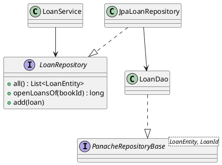

# Ex - Quarkus - JPA - Panache

##fragment

> Three hand-written DAOs go, Panache comes. 🧩
> Turn the catalogue into active record for authors, a `PanacheRepository` for books, `PanacheQuery` for paging, counting and projections, and a domain repository for loans - with every curl answering exactly as before

### 🙋 A quick survey first
Before we delete a single DAO, we collect.

##fragment

> - Open `BookDao` and `AuthorDao`. Which methods would look the same in a third DAO? ##fragment
> - `LoanService` calls `loans.countOpen(...)`. Does the service care whether a database is behind it? ##fragment
> - Which class of the catalogue would you let save itself: `AuthorEntity`, `BookEntity`, `LoanEntity`? ##fragment

##fragment
- 👉 Write down your answer to the last question - at the end of the lesson we compare it with what we built

### 🎯 What we build today
##side-by-side-start
#### The same catalogue
- `GET/POST/DELETE /books`, paging, filter by author and genre
- `GET /authors`, `/authors/stats`, `/authors/{id}/books`
- `POST /loans` with rollback and `409`, the audit with `REQUIRES_NEW`
- Every curl from last time answers exactly as before

##separator
##fragment

#### ... with less code
- `AuthorDao` and `BookDao` are **deleted**
- `AuthorEntity` finds and saves itself (active record)
- `BookRepository` with two methods replaces 50 lines of DAO
- Two new endpoints: `GET /books/count`, `GET /books/titles`
- `LoanService` talks to a **domain repository**, not to a DAO

##side-by-side-end
##fragment

> [!note]
> The theory is in [[Quarkus - JPA - Panache]]: active record, repository, unit of work and the difference between a `PanacheRepository` and a domain repository (Fowler, Evans). This exercise continues the code from [[Ex - Quarkus - JPA - EntityManager and Transactions]]: same entities, same database, same `@Transactional`. Only the **data access** changes.

### 🏁 The destination
```bash
curl "localhost:8080/books?page=0&size=1"
curl "localhost:8080/books/count?author=lem"
curl localhost:8080/books/titles
```

##fragment
- Expected at the end of the lesson: a list with only `Dune`, then `1`, then `[{"title":"Dune","year":1965},{"title":"Solaris","year":1961}]`
- The last one is a **projection**: two columns from the database, straight into a record, no entity in between
- And `./mvnw test` ends with **41 tests**, all green

### 🕐 Agenda: 100 minutes
| Step | Minutes | Content                                              | You end the step with                                    |
| ---- | ------- | ---------------------------------------------------- | -------------------------------------------------------- |
| 0    | 8       | Clone, run, run the tests                            | `curl localhost:8080/books` returns two books, 35 tests green |
| 1    | 5       | Swap the extension in the pom                        | Dev mode starts with Panache, nothing else changed       |
| 2    | 18      | Active record: `AuthorEntity extends PanacheEntityBase` | `AuthorDao` is deleted, `/authors` still works        |
| 3    | 20      | Repository: `BookRepository`                         | `BookDao` is deleted, `/books` still works               |
| 4    | 14      | `PanacheQuery`: paging, count, projection            | `/books/count` and `/books/titles` answer                |
| -    | 5       | One use case, two patterns                           | You can say which pattern each class uses                |
| 5    | 18      | Domain repository for loans                          | `LoanService` sees only `LoanRepository`, `409` still works |
| 6    | 12      | Tests                                                | 41 tests green                                           |

##fragment
- Each step ends with a **checkpoint** ⏰: stop there until the class is with you
- Every step keeps the application **compiling and running** - if your step 3 is broken, step 4 is still explainable from the deck and `final-code`

### 🧰 Setup: clone the starter
```bash
git clone <STARTER-REPO-URL> catalogue-panache
cd catalogue-panache
```

##fragment
- Open the folder in **IntelliJ IDEA Ultimate**, let it import the Maven project
- Quarkus 3.40, Java 25 or newer, **Docker or Podman must run**: Dev Services starts PostgreSQL for dev mode and for the tests
- This is the end state of the last exercise: `AuthorDao`, `BookDao` and `LoanDao` on a plain `EntityManager`

## 🚀 Step 0: Run what we have
> Before we change the data access, we record how the application answers today.

### ▶️ Start dev mode
```bash
./mvnw quarkus:dev
curl localhost:8080/books
curl localhost:8080/authors
```

##fragment
- Expected: `Dune` (id 1) and `Solaris` (id 2), then `Herbert` with `["Dune"]` and `Lem` with `["Solaris"]`
- The SQL log is on (`quarkus.hibernate-orm.log.sql=true`): watch the terminal while you curl, we will compare it after every step
- Keep dev mode running - it reloads after every change you save

### 🧪 The safety net
In a second terminal:

##fragment

```bash
./mvnw test
```

##fragment
- Expected: `Tests run: 35, Failures: 0`
- These tests do not know about DAOs: they talk HTTP or call the services. That is why they can tell us after every step whether the refactoring broke something

### ⏰ Everybody ready?
> Two books, two authors, 35 green tests. If Dev Services cannot start, check that Docker or Podman runs

## 📦 Step 1: Swap the extension
> One dependency, nothing else.

### 🔧 The pom
In `pom.xml`, find the dependency `quarkus-hibernate-orm` and change its `artifactId`:

##fragment

```xml
        <dependency>
            <groupId>io.quarkus</groupId>
            <artifactId>quarkus-hibernate-orm-panache</artifactId>
        </dependency>
```

##fragment
- `quarkus-hibernate-orm-panache` **includes** `quarkus-hibernate-orm`: replace it, do not add a second dependency
- `application.properties` stays as it is: data source, schema strategy, SQL log
- Press the Maven reload button in IntelliJ (the small `m` icon)

### ▶️ Verify
Stop dev mode with `Ctrl+C` and start it again, so the new dependency is loaded:

##fragment

```bash
./mvnw quarkus:dev
curl localhost:8080/books
```

##fragment
- Expected: the same two books as before
- The installed features in the start log now contain `hibernate-orm-panache`
- Panache is a layer **on top of** Hibernate ORM: the entities, the mapping and the SQL are unchanged

### ⏰ Panache on board?
> `hibernate-orm-panache` in the feature list, `/books` answers as before

## 🧱 Step 2: Active record for authors
> The entity knows how to find and save itself - `AuthorDao` goes.

### ⚠️ `PanacheEntity` or `PanacheEntityBase`?
##side-by-side-start
#### `extends PanacheEntity`
- Brings its own `public Long id` with `@GeneratedValue`
- That is a **sequence** strategy, like `BookEntity`
- Our `import.sql` inserts authors **without** an id: `INSERT INTO author (name) VALUES ('Herbert'), ('Lem');`
- With a sequence the `id` column has no default: the import fails

##separator
##fragment

#### `extends PanacheEntityBase`
- Brings all the Panache methods, but **no** id
- We keep our own `@Id @GeneratedValue(strategy = GenerationType.IDENTITY) public Long id`
- The database generates the key, the import keeps working
- Same rule for UUID keys or composite keys: always `PanacheEntityBase`

##side-by-side-end
##fragment
- 👉 `PanacheEntity` is a shortcut for the common case. As soon as you need your own key, you write it yourself and extend the base class

### 🧱 Extend the base class
In `AuthorEntity`, change the class declaration:

##fragment

```java
public class AuthorEntity extends PanacheEntityBase {
```

##fragment
- Import `io.quarkus.hibernate.orm.panache.PanacheEntityBase`
- The fields `id`, `name`, `books` and the methods `addBook`, `toAuthor` stay exactly as they are
- From now on `AuthorEntity` has static methods like `findById`, `list`, `find`, `count` and instance methods like `persist`, `delete`

### 🔍 The first static finder
Add this method to `AuthorEntity`, below the fields:

##fragment

##side-by-side-start
```java
    public static Optional<AuthorEntity> findByName(String name) {
        return find("name", name).firstResultOptional();
    }
```

##separator
##fragment

- A single field name is the short form: Panache expands `"name"` to `from AuthorEntity where name = ?1`
- `find` returns a query, `firstResultOptional()` runs it and returns the first row, or an empty `Optional`
- The method is **static**: it works on the table, not on one row
- Import `java.util.Optional`

##side-by-side-end

### 🔗 Two more finders
Add them next to `findByName`:

##fragment

##side-by-side-start
```java
    public static List<AuthorEntity> listWithBooks() {
        return list("select distinct a from AuthorEntity a left join fetch a.books order by a.name");
    }

    public static List<AuthorStats> stats() {
        return getEntityManager().createQuery("""
                        select new at.htl.catalogue.AuthorStats(a.name, count(b))
                        from AuthorEntity a left join a.books b
                        group by a.name
                        order by a.name""", AuthorStats.class)
                .getResultList();
    }
```

##separator
##fragment

- `listWithBooks` is the `join fetch` query from last time: Panache accepts a full HQL query as well as the short form
- `stats` returns a **DTO**, not an entity. For that we use the `EntityManager` directly: `getEntityManager()` is inherited from `PanacheEntityBase`
- Copy both query strings from `AuthorDao` - they do not change

##side-by-side-end
##fragment
- ⏰ Short stop: `AuthorEntity` has three static finders and IntelliJ shows no red. The services follow next

### 🛠️ `AuthorService` without a DAO
In `AuthorService`, **delete** the `AuthorDao` field and the constructor. Then change the three calls:

##fragment

##side-by-side-start
```java
        return AuthorEntity.listWithBooks().stream()
```

```java
        return AuthorEntity.stats();
```

```java
        AuthorEntity author = AuthorEntity.<AuthorEntity>findByIdOptional(authorId)
```

##separator
##fragment

- The service has **no dependencies** any more: it calls static methods of the entity
- `findByIdOptional` is inherited and generic. `<AuthorEntity>` tells the compiler which type comes back; without it you would get an `Optional` of `PanacheEntityBase`
- The `.orElseThrow(...)` after it stays as it is

##side-by-side-end

### 🛠️ `BookService` finds and saves authors
In `BookService`, delete the `AuthorDao` field and its constructor parameter. Then change `authorNamed`:

##fragment

##side-by-side-start
```java
    private AuthorEntity authorNamed(String name) {
        return AuthorEntity.findByName(name)
                .orElseGet(() -> {
                    AuthorEntity author = new AuthorEntity();
                    author.name = name;
                    author.persist();
                    return author;
                });
    }
```

##separator
##fragment

- `AuthorEntity.findByName(name)` instead of `authors.findByName(name)`
- `author.persist()` instead of `authors.add(author)`: the **object** saves itself, that is the active record idea
- `persist()` does not send the `INSERT` immediately: the unit of work writes it at commit, as before

##side-by-side-end
##fragment
- Now **delete** `AuthorDao.java`. If IntelliJ still finds a usage, it shows you where

### ▶️ Verify
```bash
curl localhost:8080/authors
curl localhost:8080/authors/stats
curl -X POST localhost:8080/books -H "Content-Type: application/json" \
     -d '{"title":"The Left Hand of Darkness","author":"Le Guin","year":1969}'
curl localhost:8080/authors
```

##fragment
- Expected: the two authors with their titles, then `[{"name":"Herbert","bookCount":1},{"name":"Lem","bookCount":1}]`
- The `POST` answers `201`, and the last list contains `Le Guin`: the author was created by `author.persist()`
- In the SQL log: the `left join fetch` query for `/authors` is the same SQL as before - Panache only changed where the code lives

### ⏰ `AuthorDao` gone?
> No class named `AuthorDao` exists, `/authors` and `/authors/stats` answer as before, `Le Guin` was created

## 🗄️ Step 3: A repository for books
> The entity stays plain, a bean does the data access - `BookDao` goes.

### 🔁 Before and after
##side-by-side-start
#### Before: part of `BookDao` (starter)
```java
    public List<BookEntity> findByAuthor(String name, int first, int max) {
        return em.createQuery("""
                        select b from BookEntity b
                        join b.author a
                        where lower(a.name) = lower(:name)
                        order by b.id""", BookEntity.class)
                .setParameter("name", name)
                .setFirstResult(first)
                .setMaxResults(max)
                .getResultList();
    }
```

- Plus `findById`, `findAll`, `findByGenre`, `add`, `remove`: 50 lines

##separator
##fragment

#### After: the whole `BookRepository`
```java
@ApplicationScoped
public class BookRepository implements PanacheRepository<BookEntity> {

    public PanacheQuery<BookEntity> byAuthor(String name) {
        return find("lower(author.name) = lower(?1)", Sort.by("id"), name);
    }

    public List<BookEntity> byGenre(Genre genre) {
        return list("#BookEntity.byGenre", Parameters.with("genre", genre));
    }
}
```

- `findById`, `persist`, `deleteById`, `listAll`, `count` are **inherited**

##side-by-side-end
##fragment
- 👉 Only the two queries that are specific to books are left. Everything generic comes from `PanacheRepository`

### 🧱 Create `BookRepository`
Create `BookRepository` in `at.htl.catalogue` with the code from the right side above.

##fragment

- `implements PanacheRepository<BookEntity>`: the id type is `Long`, so the short interface fits. For other key types there is `PanacheRepositoryBase<Entity, IdType>`
- `byAuthor` returns a `PanacheQuery`, **not** a list: the caller decides about paging and counting (step 4)
- `author.name` navigates the association, Hibernate generates the join - no `join b.author a` needed
- `#BookEntity.byGenre` calls the existing `@NamedQuery` on `BookEntity`
- Imports from `io.quarkus.hibernate.orm.panache` (`PanacheQuery`, `PanacheRepository`) and `io.quarkus.panache.common` (`Parameters`, `Sort`)

##fragment
- ⏰ Short stop: `BookRepository` compiles. `BookDao` still exists until the end of this step

### 🛠️ Rewire `BookService`
Change the field and the constructor parameter from `BookDao` to `BookRepository`:

##fragment

##side-by-side-start
```java
    private final BookRepository books;
```

```java
    public BookService(BookRepository books,
```

##separator
##fragment

- The field keeps its name `books`, so most calls only change their method name
- The repository is a normal `@ApplicationScoped` bean: constructor injection as everywhere else

##side-by-side-end

### ✏️ Four renamed calls
In `BookService`, change these calls:

##fragment

##side-by-side-start
```java
        return books.byGenre(genre).stream()
```

```java
        return books.findByIdOptional(id)
```

```java
        books.persist(entity);
```

```java
        books.deleteById(id);
```

##separator
##fragment

- `findByGenre` -> `byGenre` (our method)
- `findById` -> `findByIdOptional` (inherited): Panache's `findById` returns `null`, the `Optional` version fits the existing `.map(...).orElseThrow(...)`
- `add` -> `persist`
- `remove`: `deleteById(id)` replaces the whole line with `ifPresent`. Deleting an unknown id simply does nothing, as before

##side-by-side-end

### 📄 `find` with a `PanacheQuery`
`BookDao.findAll(first, max)` does not exist any more. Replace the body of `find` and add a private helper at the end of the class:

##fragment

##side-by-side-start
```java
    @Timed
    public List<Book> find(String author, int page, int size) {
        int max = Math.min(size, config.maxResults());
        return query(author)
                .page(Page.of(page, max))
                .list()
                .stream()
                .map(BookEntity::toBook)
                .toList();
    }
```

```java
    private PanacheQuery<BookEntity> query(String author) {
        return author == null
                ? books.findAll(Sort.by("id"))
                : books.byAuthor(author);
    }
```

##separator
##fragment

- `query(author)` builds the query, **without** running it: all books, or the books of one author, both sorted by `id`
- `page(Page.of(page, max))` replaces `setFirstResult` / `setMaxResults`: Panache counts in **pages**, not in rows
- `list()` finally runs the SQL
- We look at `PanacheQuery` in detail in step 4

##side-by-side-end

### 🛠️ `LoanService` uses the repository too
`LoanService` also depends on `BookDao`. Change the field, the constructor parameter and one call:

##fragment

##side-by-side-start
```java
    private final BookRepository books;
```

```java
        BookEntity book = books.findByIdOptional(request.bookId())
```

##separator
##fragment

- The constructor parameter `BookDao books` becomes `BookRepository books`
- The `LoanDao` stays for now: it becomes the domain repository in step 5
- Now **delete** `BookDao.java`

##side-by-side-end
##fragment
- ⏰ Short stop: the project compiles without `BookDao` before we curl

### ▶️ Verify
```bash
curl localhost:8080/books
curl "localhost:8080/books?author=lem"
curl "localhost:8080/books?genre=SCIENCE_FICTION"
curl localhost:8080/books/1
```

##fragment
- Expected: both books, then only `Solaris`, then both books sorted by title, then `Dune`
- In the SQL log the author filter still joins `author` and compares `lower(...)` - Hibernate generated the join from `author.name`
- 👉 `curl localhost:8080/books/9999` still answers `404`: `findByIdOptional` plus the existing exception mapper

### ⏰ `BookDao` gone?
> No class named `BookDao` exists, the four curls answer as before. If something does not compile, compare `BookService` with `final-code`

## 📄 Step 4: `PanacheQuery`
> One query object, many ways to run it.

### 🧠 A query that has not run yet
##side-by-side-start
#### Building
- `books.findAll(Sort.by("id"))`
- `books.byAuthor("lem")`
- `find(...)` and `findAll(...)` return a `PanacheQuery<BookEntity>`
- **No SQL** has been sent yet

##separator
##fragment

#### Running
- `.list()` - all rows
- `.page(...).list()` - one page
- `.count()` - `select count(*)` with the same `where`
- `.firstResult()`, `.firstResultOptional()` - one row
- `.project(Dto.class).list()` - selected columns into a record

##side-by-side-end
##fragment
- One `query(author)`, three uses: the list (step 3), the count and - with `findAll` - the projection. The `where` clause exists only **once**

### 🔢 Count the books
Add to `BookService`, next to `find`:

##fragment

##side-by-side-start
```java
    public long count(String author) {
        return query(author).count();
    }
```

##separator
##fragment

- The same helper as for the list - the count can never disagree with the filter of the list
- Panache leaves out the `order by` for the count, it would be useless there

##side-by-side-end
##fragment

Add to `BookResource`, **above** the method with `@Path("/{id}")`:

##fragment

```java
    @GET
    @Path("/count")
    public long count(@QueryParam("author") String author) {
        return service.count(author);
    }
```

##fragment
- Above `/{id}` keeps the file readable; Quarkus prefers the literal path `/count` over the template `/{id}` anyway
- Without `?author=` the parameter is `null`, so `query(null)` counts all books

### 🎯 A projection
Create the record `BookTitle`:

##fragment

```java
public record BookTitle(String title, int year) {
}
```

##fragment
- The component names `title` and `year` must match the **field names** of `BookEntity`: Panache builds `select title, year` from them
- It reads the names at runtime, which works because the pom compiles with `<parameters>true</parameters>` - already there in the starter

### 🎯 The projection in service and resource
Add to `BookService`:

##fragment

```java
    public List<BookTitle> titles() {
        return books.findAll(Sort.by("title"))
                .project(BookTitle.class)
                .list();
    }
```

##fragment

And to `BookResource`, next to `count`:

##fragment

```java
    @GET
    @Path("/titles")
    public List<BookTitle> titles() {
        return service.titles();
    }
```

##fragment
- `project(BookTitle.class)` is the DTO projection from last time, **without** writing `select new at.htl.catalogue....`
- Imports in `BookService`: `io.quarkus.hibernate.orm.panache.PanacheQuery`, `io.quarkus.panache.common.Page`, `io.quarkus.panache.common.Sort`

### ▶️ Verify
```bash
curl "localhost:8080/books?page=0&size=1"
curl localhost:8080/books/count
curl "localhost:8080/books/count?author=lem"
curl localhost:8080/books/titles
```

##fragment
- Expected: `[{"id":1,"title":"Dune",...}]`, then `2`, then `1`, then `[{"title":"Dune","year":1965},{"title":"Solaris","year":1961}]`
- `Le Guin` from step 2 is gone: on every reload dev mode drops and recreates the schema and runs `import.sql` again
- In the SQL log the projection selects **only** `title` and `published_year` - no `id`, no `genre`, no `isbn`
- 👉 Try `?page=1&size=1`: which book comes back, and why?

### ⏰ Count and titles?
> `/books/count` and `/books/titles` answer, the projection has no `id` field

## ⚖️ One use case, two patterns
> Look at `BookService.add` - you just typed both patterns into it.

### 🔍 Adding a book
##side-by-side-start
#### Active record
```java
        return AuthorEntity.findByName(name)
```

```java
                    author.persist();
```

- Static call on the **class** for the table
- Instance call on the **object** for the row
- `BookService` does not declare that it needs authors: the dependency is hidden in a static call

##separator
##fragment

#### Repository
```java
        books.persist(entity);
```

```java
    public BookService(BookRepository books,
```

- Instance call on an **injected bean**
- The dependency is visible in the **constructor**
- `BookEntity` extends nothing: it is a plain JPA entity

##side-by-side-end
##fragment
- Both end in the same `persist` on the same persistence context, inside the same `@Transactional`: same SQL, same commit

### 📊 The comparison
| Criterion                      | `AuthorEntity` (active record)    | `BookRepository` (repository)        |
| ------------------------------ | --------------------------------- | ------------------------------------ |
| Where do the queries live?     | static methods in the entity      | methods of the repository bean       |
| Entity depends on Panache      | yes, `extends PanacheEntityBase`  | no                                   |
| Dependency visible             | no, static call                   | yes, constructor parameter           |
| Replace it in a test           | `PanacheMock` (extra extension)   | `@InjectMock`, as in the testing exercise |
| Unit of work, dirty checking   | the same                          | the same                             |

##fragment
- One project may use both, but **one style per entity** - a second way to load authors would only confuse
- 👉 Compare with your note from the survey: would you choose differently now?

## 🏛️ Step 5: A domain repository for loans
> A `PanacheRepository` is a comfortable DAO. Now we build the repository Fowler and Evans meant.

### 🧠 Why another layer?
> "Mediates between the domain and data mapping layers using a collection-like interface for accessing domain objects."
> - Martin Fowler, Patterns of Enterprise Application Architecture

##fragment

- `BookRepository` offers `find(String, ...)`, `getEntityManager()`, `deleteAll()`: every caller sees HQL and JPA
- A **domain repository** is an interface in the language of the use case: "all loans", "open loans of a book", "add a loan"
- `LoanService` should not know whether a database, a REST service or a `HashMap` is behind it
- 👉 Panache does the work **behind** the interface, as the theory deck shows in [[Quarkus - JPA - Panache]]

### 🗺️ What we build


##fragment
- `LoanService` depends only on the interface
- `JpaLoanRepository` and `LoanDao` are **package-private**: nobody outside the package can bypass the interface
- Today everything stays in the flat package `at.htl.catalogue`; separate `domain` and `persistence` packages are an extension

### 🧱 The interface
Create `LoanRepository`:

##fragment

##side-by-side-start
```java
// the domain's view of loans: no Panache, no JPA in the signatures
public interface LoanRepository {

    List<LoanEntity> all();

    long openLoansOf(long bookId);

    void add(LoanEntity loan);
}
```

##separator
##fragment

- Collection-like: `all`, `add` - as if the loans were in a list in memory
- `openLoansOf` is named after the **business question**, not after the SQL
- No `PanacheQuery`, no HQL string, no `EntityManager` in the signatures

##side-by-side-end

### 🧱 The Panache DAO
Replace the whole content of `LoanDao` - the class becomes empty:

##fragment

##side-by-side-start
```java
@ApplicationScoped
class LoanDao implements PanacheRepositoryBase<LoanEntity, LoanId> {
}
```

##separator
##fragment

- `PanacheRepositoryBase` because the key is the composite `LoanId`, not a `Long`
- All methods we need (`listAll`, `count`, `persist`) are inherited, so the body is empty
- **No** `public`: package-private
- Import `io.quarkus.hibernate.orm.panache.PanacheRepositoryBase`, remove the unused imports of `EntityManager` and `List`

##side-by-side-end

### 🧱 The implementation
Create `JpaLoanRepository`:

##fragment

##side-by-side-start
```java
@ApplicationScoped
class JpaLoanRepository implements LoanRepository {

    private final LoanDao dao;

    JpaLoanRepository(LoanDao dao) {
        this.dao = dao;
    }

    @Override
    public List<LoanEntity> all() {
        return dao.listAll();
    }

    @Override
    public long openLoansOf(long bookId) {
        return dao.count("book.id = ?1 and returnDate is null", bookId);
    }

    @Override
    public void add(LoanEntity loan) {
        dao.persist(loan);
    }
}
```

##separator
##fragment

- The only class that knows the HQL of loans
- `count("...", bookId)` is the `countOpen` query from last time, as a one-liner
- CDI injects `JpaLoanRepository` wherever a `LoanRepository` is requested: it is the only implementation
- Tomorrow a second implementation (in memory, for a test) needs no change in `LoanService`

##side-by-side-end

### 🛠️ `LoanService` on the interface
In `LoanService`, change the field and the constructor parameter from `LoanDao` to `LoanRepository`, then the two calls:

##fragment

##side-by-side-start
```java
    private final LoanRepository loans;
```

```java
        return loans.all().stream()
```

```java
        if (loans.openLoansOf(book.id) > 1) {
```

##separator
##fragment

- `findAll()` -> `all()`, `countOpen` -> `openLoansOf`, `loans.add(loan)` keeps its name
- The constructor now starts with `LoanRepository loans, BookRepository books`
- `@Transactional`, the check **after** the insert and the rollback are untouched: the count query flushes the insert, the exception rolls it back

##side-by-side-end

### ▶️ Verify: the rollback still works
```bash
curl -i -X POST localhost:8080/loans -H "Content-Type: application/json" \
     -d '{"bookId":1,"memberId":"00000000-0000-0000-0000-000000000001"}'
curl -i -X POST localhost:8080/loans -H "Content-Type: application/json" \
     -d '{"bookId":1,"memberId":"00000000-0000-0000-0000-000000000002"}'
curl localhost:8080/loans
curl localhost:8080/audit
```

##fragment
- Expected: `201 Created` for Ada, then `409 Conflict` with `{"message":"Book 1 is already lent"}` for Alan
- `/loans` lists **one** loan: Alan's insert was rolled back
- `/audit` lists **both** attempts: `AuditLog.write` runs in `REQUIRES_NEW` and survives the rollback
- 👉 Nothing in the transaction logic changed - only the type `LoanService` depends on

### ⏰ Domain repository in place?
> `LoanService` imports neither `LoanDao` nor anything from Panache, `201` then `409` as before

## 🧪 Step 6: Tests
> The 35 old tests were our safety net. Now we add tests for what is new.

### 🧩 `PanacheTest`
Create `PanacheTest` in `src/test/java/at/htl/catalogue`:

##fragment

##side-by-side-start
```java
@QuarkusTest
@TestTransaction
class PanacheTest {

    @Inject
    BookRepository books;

    @Inject
    LoanRepository loans;

    @Test
    void activeRecordFinder() {
        assertTrue(AuthorEntity.findByName("Lem").isPresent());
        assertTrue(AuthorEntity.findByName("Unknown Author").isEmpty());
    }

    @Test
    void repositoryQuery() {
        assertEquals("Dune", books.byAuthor("herbert").firstResult().title);
    }
}
```

##separator
##fragment

- `@TestTransaction` runs every test in a transaction that is **rolled back** at the end: nothing a test writes stays in the database
- The active record needs no injection: static call on the class
- The repository is a bean: `@Inject`
- `byAuthor` returns a `PanacheQuery`, `firstResult()` runs it for one row
- Imports: `io.quarkus.test.TestTransaction`, `io.quarkus.test.junit.QuarkusTest`, `jakarta.inject.Inject`, the static `Assertions`

##side-by-side-end

### ➕ Persist and the domain repository
Add two more tests to `PanacheTest`:

##fragment

##side-by-side-start
```java
    @Test
    void activeRecordPersist() {
        AuthorEntity author = new AuthorEntity();
        author.name = "Butler";
        author.persist();

        assertEquals(author.id, AuthorEntity.findByName("Butler").orElseThrow().id);
    }

    @Test
    void domainRepositoryCountsOpenLoans() {
        assertEquals(0, loans.openLoansOf(1L));
    }
```

##separator
##fragment

- `persist()` needs a transaction - `@TestTransaction` provides it
- The finder query flushes the insert first, so `Butler` is found with the generated id
- The last test talks only to the **interface** `LoanRepository`: it does not know there is a `LoanDao`
- After the test the rollback removes `Butler` again

##side-by-side-end

### 🌐 HTTP tests for the new endpoints
Add to `BookResourceTest`:

##fragment

```java
    @Test
    void countByAuthor() {
        given()
          .queryParam("author", "lem")
          .when().get("/count")
          .then()
             .statusCode(200)
             .body(equalTo("1"));
    }

    @Test
    void titlesAreAProjection() {
        given()
          .when().get("/titles")
          .then()
             .statusCode(200)
             .body("find { it.title == 'Dune' }.year", equalTo(1965))
             .body("[0].id", nullValue());
    }
```

##fragment
- `body(equalTo("1"))` compares the whole response body, a plain number
- `"[0].id"` is `null`: the projection has no `id` - proof that it is not the full entity
- Add the static import `org.hamcrest.Matchers.nullValue`

### ▶️ Run everything
```bash
./mvnw test
```

##fragment
- Expected: `Tests run: 41, Failures: 0` - the 35 old ones plus 6 new ones
- The old tests passed without a single change: the refactoring kept every endpoint and every service method

### ⏰ 41 green?
> If a test is red, read its name first: it tells you which step to compare with `final-code`

## 🌍 Summary
### 📋 What you built
> - `quarkus-hibernate-orm-panache` instead of `quarkus-hibernate-orm`, the configuration unchanged
> - `AuthorEntity extends PanacheEntityBase`: active record with static finders, keeps its `IDENTITY` key
> - `BookRepository implements PanacheRepository<BookEntity>`: two methods instead of a whole DAO
> - `PanacheQuery`: one query, used for `page(...)`, `count()` and `project(BookTitle.class)`
> - `LoanRepository`: a domain repository, implemented with a package-private Panache DAO
> - Two DAOs deleted, 41 tests green

##fragment
- 👉 Compare your version with `final-code`: which names differ, and does anything still use the `EntityManager` directly?

### 🚀 Extensions for fast ones
> - `MemberEntity` as active record, so `LoanService` loses its last `EntityManager` ##fragment
> - Books with Jakarta Data: a `@Repository` interface instead of a class ##fragment
> - Sorting by year and an `X-Total-Count` header for paging ##fragment
> - `domain` and `persistence` packages for the loans ##fragment

##fragment
- 👉 Details and hints on the next slides

### 🚀 Extension 1: `MemberEntity` as active record
`LoanService.lend` still calls `em.find(MemberEntity.class, ...)`.

##fragment

- Let `MemberEntity` extend `PanacheEntityBase` - **not** `PanacheEntity`: the key is a `UUID` created in Java, there is no sequence
- Replace the `em.find(...)` and the `null` check with `MemberEntity.<MemberEntity>findByIdOptional(request.memberId()).orElseThrow(...)`
- Remove the `EntityManager` field and constructor parameter from `LoanService`
- 👉 Check: the two loan curls still answer `201` and `409`, all tests stay green

### 🚀 Extension 2: Jakarta Data
Write the book queries as an interface and let Hibernate generate the implementation.

##fragment

- Hint: an interface `Books extends CrudRepository<BookEntity, Long>` with `@Repository` (all from `jakarta.data`)
- Declare `@Find List<BookEntity> byGenre(Genre genre);` and a `@Query("where lower(author.name) = lower(:name) order by id")` method
- It needs the Hibernate annotation processor (`hibernate-processor`) in the compiler configuration of the pom
- ⚠️ Hibernate's implementation uses a **stateless session**: no dirty checking - read the deep dive in [[Quarkus - JPA - Panache]] first
- 👉 Use it only in a new endpoint, keep `BookRepository` for the rest

### 🚀 Extension 3: sorting and a total count
- Add a query parameter `sort=year` to `GET /books`: then use `Sort.by("year").descending()` instead of `Sort.by("id")`
- Return a `Response` with the header `X-Total-Count` (the result of `count()`) next to the list
- Hint: `pageCount()` and `hasNextPage()` of `PanacheQuery` answer "how many pages?" and "is there more?" - after `page(...)` was called
- 👉 Check with `curl -i "localhost:8080/books?page=0&size=1"`: the header says `2`

### 🚀 Extension 4: packages for the layers
- Move `LoanRepository` into `at.htl.catalogue.domain`
- Move `JpaLoanRepository` and `LoanDao` into `at.htl.catalogue.persistence`
- `LoanDao` and `JpaLoanRepository` stay package-private: they only see each other, and CDI still finds the bean behind `LoanRepository`
- 👉 Which imports does `LoanService` have now? None from `persistence` - that is the dependency inversion from the theory deck

## Questions ?
![[Pasted image 20240424074417.png]]

## References
- https://quarkus.io/guides/hibernate-orm-panache
- https://quarkus.io/guides/hibernate-orm
- https://quarkus.io/guides/getting-started-testing
- https://jakarta.ee/specifications/data/
- https://martinfowler.com/eaaCatalog/activeRecord.html
- https://martinfowler.com/eaaCatalog/repository.html
- https://www.domainlanguage.com/ddd/

## 📎 Optional deep dives and backup slides
### 🔬 Deep dive: why `<AuthorEntity>findByIdOptional`?
- `findByIdOptional` is declared in `PanacheEntityBase` as `static <T extends PanacheEntityBase> Optional<T> findByIdOptional(Object id)`
- Static methods are not overridden: at compile time Java does not know that you called it **on** `AuthorEntity`
- Quarkus rewrites the call at build time so that it really queries `AuthorEntity`, but the **compiler** still needs the type witness
- `findByName` needs none: its return type is declared in our own code

### 🔬 Deep dive: public fields without getters
- Panache entities use `public` fields, as in the catalogue since the mapping exercise
- At build time Quarkus generates a getter and setter for every public field and rewrites every field access (`author.name = name`) into a call
- So lazy loading and dirty checking still work, although the code looks like plain field access
